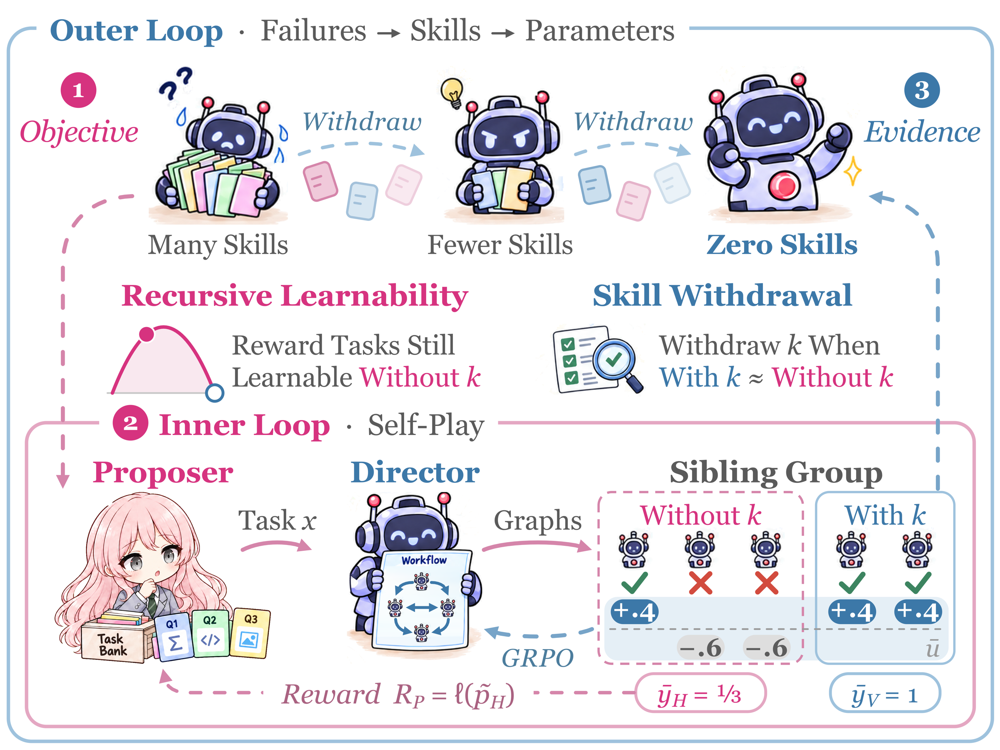
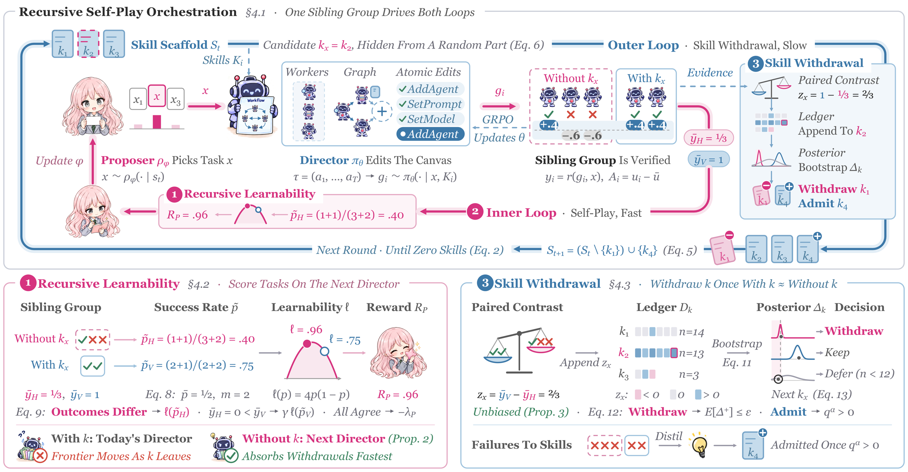

# R²Orch: Recursive Self-Improvement for Agent Orchestration via Self-Play within a Skill-Internalization Loop

<div align="center">

### Self-play on self-chosen tasks, skills withdrawn once internalized, zero skills at deployment



</div>

## Overview

R²Orch trains an LLM **Director** that builds an agent graph for every task, one atomic edit at a time; frozen
**Workers** execute the graph. Training follows a paradigm of *Recursive Self-Play Orchestration*: an inner loop of
self-play improves the Director on tasks that a learned **Proposer** chooses, and an outer loop improves how the
inner loop improves by withdrawing the Director's skills one by one. Failures are distilled into skills, skills
into parameters, and each withdrawal leads the Proposer to new failures, so the Director converges toward
zero-skill deployment. The repository implements the three components of the paper:

- **Recursive Self-Play Orchestration**: two nested loops on two time scales, joined by one randomized rollout
  group per task. A random hidden part of the group reads the context without one candidate skill, the visible
  part reads it with the skill; the same group trains the Director, scores the Proposer and tests the skill.
- **Recursive Learnability**: the Proposer is rewarded for tasks whose rollouts keep reaching different outcomes
  as skills are withdrawn, i.e. the learnability of the task on the context the next Director reads.
- **Skill Withdrawal**: each group is a randomized block, so the visible-minus-hidden contrast is an unbiased
  estimate of the skill's benefit. A Bayesian-bootstrap posterior over these contrasts withdraws a skill once
  the Director no longer needs it and admits a new skill once it helps.

## Method

<div align="center">
  
</div>

### Agent graphs

An agent graph has one agent per node (a role prompt and a model route), directed or bidirectional hand-offs as
edges, a layer for every agent and one output agent. The Director starts from an empty canvas and issues one
edit per turn; every edit is validated and applied before the next one, and Worker feedback returns to the canvas:

```text
AddAgent  SetPrompt  SetModel  SetLayer  ConsiderRelation  DeleteAgent  SetOutput  Finish
```

The Workers are the frozen base model.

### Recursive Self-Play Orchestration

Every cycle the Proposer picks tasks from candidate lists, and the Director builds G = 5 graphs per task. The
scaffold (the skill library) chooses one candidate skill k for the task by a Thompson draw; a random hidden part
of n_h = 3 rollouts reads the retrieved skills without k, the visible part of n_v = 2 reads them with k. On the fast
time scale both policies take proximal steps: the Director a group-relative policy-gradient (GRPO) step with a KL
anchor on the reward u = correctness - lambda * Worker cost, the Proposer a pairwise policy-gradient step with a KL
anchor to its untrained reference. On the slow time scale the outer loop updates the scaffold from the same groups.
Because most rollouts already train without the candidate skill, the skill is internalized before it leaves.

### Recursive Learnability

The Proposer's reward is a plug-in estimate of the learnability l(p) = 4p(1 - p) on the hidden part of the group,
the part that already reads the next Director's context:

```text
R_P(x) = (1 - c_x) * gamma^h_x * l(p~_x) - lambda_P * c_x,     p~_x = (successes + m * p_bar) / (rollouts + m)
```

c_x flags a group whose rollouts all reach the same outcome, h_x switches the estimate to the visible part when
the hidden part has no success (discounted by gamma), and the Beta prior shrinks toward the scope's running hidden
success rate p_bar with strength m. The reward is scaled by a compute factor (mean task duration / task duration)^eta.
The Proposer chooses two distinct candidates of eight per list (four from an ADS curriculum, four by TSDS
similarity) and is trained with each pick as the other's baseline: its advantage is half the reward difference of
the pair, scaled to unit root mean square over the batch.

### Skill Withdrawal

For the task's candidate skill k, the group gives the paired contrast z_x = mean(visible) - mean(hidden). The
skill ledger keeps a Bayesian-bootstrap posterior of each skill's benefit over its recorded contrasts and decides:

```text
withdraw k  if  n_k >= n_min  and  E[max(Delta_k, 0)] <= epsilon
admit k     if  n_k >= n_min  and  Pr(Delta_k <= 0) <= alpha
```

so each withdrawal costs at most epsilon in posterior expectation. The least helpful skill is revised first, and
new skills are distilled by the frozen base model from groups in which both parts fail: after the ledger's
decisions, for up to three scopes per cycle, one editor call updates or deletes the scope's skill with the lowest
posterior mean, and a second adds at most two skills from the scope's both-fail groups. A skill the editor adds or
revises enters the scaffold on trial under a new ledger key. In the released configuration the ledger reads the
last 30 cycles, 30 % of the tasks of a scope with withdrawn skills re-test one of them, and a withdrawn skill whose
evidence turns positive again is reinstated.

## Repository Layout

```text
src/r2orch/cli.py                   entry point: python -m r2orch selfplay-experiment
src/r2orch/training_cycle.py        one training cycle: picks, rollout groups, ledger, updates, outer loop
src/r2orch/proposer.py              Proposer (candidate lists, two picks per list)
src/r2orch/proposer_reward.py       Recursive Learnability reward
src/r2orch/skill_ledger.py          Skill Withdrawal: paired contrasts, posterior, decisions
src/r2orch/pats*.py                 skill revision and distillation (outer loop)
src/r2orch/canvas.py                Director canvas and atomic edits
src/r2orch/runtime.py               graph execution by the Workers, tools, submission
src/r2orch/training.py              LoRA policy updates of the Director and the Proposer
src/r2orch/benchmark_scoring.py     verifiers of the six benchmarks
configs/r2orch.toml                 configuration of the paper
configs/curriculum/r2orch.toml      curriculum profile
configs/skills/seed_cards.json      seed skills (18 cards)
configs/mock/                       offline check: tiny pool, mock models
scripts/r2orch/                     training, services; analysis/ for the paper's analyses
data/r2orch/train/                  training pool (6,154 tasks)
data/r2orch/heldout/                held-out set of the training curves (190 tasks)
data/r2orch/test/iid/               IID test sets (670 tasks)
data/r2orch/test/ood/               OOD test sets and their pinned sources
figs/                               figures from the paper
```

## Requirements

- Python 3.11+, PyTorch >= 2.6, Transformers >= 5.15, PEFT, vLLM 0.27
- One node with 4 GPUs (A100 64 GB in the paper): two serve the base model and both LoRA adapters with vLLM, one
  trains the Director, one trains the Proposer and hosts the retrieval index. Extra frozen-Worker replicas can run on
  more GPUs (`scripts/r2orch/serve_rollout_shard.sh`).
- Two auxiliary Python environments: one with `alfworld` for the ALFWorld episodes, one with `evalplus` for the
  MBPP+ tests.

All models are Qwen3.5-9B: the frozen base serves the Workers and the skill reviewer, and two LoRA adapters (rank
64) are the Director and the Proposer. No external API is called.

## Installation

```bash
git clone <repository URL> R2Orch
cd R2Orch
pip install -e ".[train,serve,ads]"
```

Check the installation without GPUs, models or services: two training cycles on a tiny pool with mock models,
mock rewards and mock policy updates.

```bash
scripts/r2orch/mock_cycle.sh runs/mock
```

Place the models and auxiliary data under one data root and export it; `configs/r2orch.toml` refers to it as
`@DATA_ROOT@`:

```bash
export R2ORCH_DATA_ROOT=/path/to/r2orch-data
```

| Item | Location under `$R2ORCH_DATA_ROOT` |
| --- | --- |
| Qwen3.5-9B | `models/Qwen3.5-9B` |
| Retriever (e5-base-v2) | `models/e5-base-v2` |
| Retrieval corpus (Search-R1 wiki-18) and its E5 vectors | `wiki18/` (vectors built by `scripts/r2orch/embed_wiki18.sh`) |
| ALFWorld data | `alfworld/json_2.1.1` |
| ALFWorld and EvalPlus interpreters | `envs/alfworld/bin/python`, `envs/evalplus/bin/python` |
| Run directories | `runs/` |

## Dataset

The training pool and the test sets are included in `data/r2orch/`. The paper evaluates twelve benchmarks: six
in-distribution (IID) benchmarks supply the training tasks and the IID tests, and six out-of-distribution (OOD)
benchmarks are used for testing only.

**IID** (`data/r2orch/train/`, `data/r2orch/heldout/`, `data/r2orch/test/iid/`):

| Benchmark | Training | Held-out | Test | Training source | Test source | Metric |
| --- | --- | --- | --- | --- | --- | --- |
| AIME | 947 | 30 | 30 | AIME 1983–2025 (real exam problems) | AIME 2026, all problems | Acc. |
| HotpotQA | 1,248 | 32 | 128 | distractor *train* | distractor *validation* | Ans EM |
| NQ-Open | 1,248 | 32 | 128 | *train* | *validation* | Ans EM |
| MedQA (USMLE, 4 options) | 1,248 | 32 | 128 | *train* | *test* | Acc. |
| MBPP+ | 215 | 32 | 128 | 247 problems | 128 other problems | Pass@1 |
| ALFWorld | 1,248 | 32 | 128 | *train* games | *valid_unseen* games | Success |

The training sources hold 1,280 tasks per benchmark (AIME: the 977 problems of the public AIME 1983–2025 sets;
MBPP+: the 247 problems that remain after the 128 test problems and the problems that duplicate a test problem up
to numbers; the others: the first 1,280 by sha256 of the task id). The held-out set takes 32 of them per benchmark (AIME: 30 problems
of earlier years), the ones with the smallest sha256 of `heldout:<benchmark>:<source id>`, and the training pool keeps
the rest. It is the held-out set for monitoring training, so the test sets are never looked at during training.

**OOD** (`data/r2orch/test/ood/`), 128 tasks each; every benchmark is posed as one IID task type (`posed_as`):

| Benchmark | Posed as | Test source | Metric | File |
| --- | --- | --- | --- | --- |
| TriviaQA | NQ-Open | rc.nocontext *validation* | Ans EM | `triviaqa.jsonl` |
| MuSiQue | HotpotQA | MuSiQue-Ans v1.0 *dev* | Ans EM | `musique.jsonl` |
| GPQA Diamond | MedQA | Diamond | Acc. | `gpqa_diamond.ids.json` (IDs only) |
| MATH-Hard | AIME | MATH *test*, level 5 | Acc. | `math_hard.jsonl` |
| SWE-Bench Verified | MBPP+ | 128 of the 500 instances | Resolved | `swe_bench_verified.jsonl` (instance, repository, base commit) |
| WebShop | ALFWorld | official human-goal test range | Success | `webshop.jsonl` (goal, product ASIN; rebuilding it reads a 5.5 GB raw file) |

Each test set keeps the first 128 candidates by ascending sha256 of `test:<benchmark>:<source id>` (AIME 2026: all
30 problems). `data/r2orch/test/ood/SOURCES.json` pins every raw source by URL revision and sha256, and
`scripts/r2orch/build_ood.py` rebuilds the files from them (`pip install -e ".[data]"`). GPQA is gated and its
questions are not redistributed: accept the terms of `Idavidrein/gpqa`, download `gpqa_diamond.csv` and run
`build_ood.py gpqa` to materialize them from the Record IDs.

```bash
python scripts/r2orch/build_ood.py text --raw raw --download                              # TriviaQA, MuSiQue, MATH-Hard
python scripts/r2orch/build_ood.py env --raw raw --download                              # SWE-Bench Verified, WebShop (5.5 GB raw file)
python scripts/r2orch/check_disjoint.py                                                    # training vs IID and OOD tests
```

The OOD files are test data only; this repository does not ship their scorers (MATH-Hard needs a math-equivalence
check, SWE-Bench its harness, WebShop its environment).

**Disjointness.** `check_disjoint.py` compares every held-out and test task with every training task of any type, and
every test task with every held-out task: the normalized question text (exact, and near-duplicates by 5-word-shingle
containment) and, for ALFWorld, the game file. It reports no exact, near-duplicate or game overlap.

Every training row carries the ADS curriculum fields (embedding, cluster, difficulty) computed with the base model;
`python -m r2orch prepare-ads-pool` recomputes them. ALFWorld rows name their game file relative to
`alfworld/json_2.1.1`.

## Training

```bash
scripts/r2orch/train.sh runs/r2orch            # 4gpu layout, configs/r2orch.toml, 200 cycles
```

`train.sh` renders the configuration, starts the retrieval service and the vLLM service with both adapters, and
runs the training driver with the settings of the paper. The same command resumes a stopped run. Variables:
`R2ORCH_CONFIG`, `R2ORCH_CYCLES`, `R2ORCH_SET` (`table.key=value` overrides), and
`R2ORCH_ROLLOUT_POOL_REGISTRY` for extra frozen-Worker replicas.

Each cycle writes `cycle-XXXX/` in the run directory (Proposer lists and picks, rollout groups, ledger summary,
training batches and metrics); checkpoints of both adapters are under `checkpoints/`.

Settings of the paper (`configs/r2orch.toml` and `train.sh`):

| Category | Setting |
| --- | --- |
| Backbone | Qwen3.5-9B for Director, Proposer, Workers and skill reviewer; LoRA rank 64 on attention and MLP projections |
| Rollout group | G = 5 per task: n_h = 3 hidden, n_v = 2 visible |
| Proposer | 2 lists x 8 candidates per benchmark and cycle, 2 picks per list; KL anchor tau = 1.0; trust region 4 nats |
| Recursive Learnability | gamma = 0.5, lambda_P = 0.2, m = 2, eta = 0.5 |
| Skill Withdrawal | epsilon = 0.02, alpha = 0.05, n_min = 12, 2,000 bootstrap draws, Thompson prior sd 0.25 |
| Director update | GRPO with clip (0.2, 0.28), KL anchor 0.005, Worker-cost weight lambda = 0.005 |
| Learning rate | 1e-5 for both adapters |
| Sampling temperature | Director 1.0, Proposer 1.0, Workers 0.3 |

## License

This repository is released for research use. Please also follow the licenses and terms of the upstream models,
datasets and benchmarks used with R²Orch, and `THIRD_PARTY_NOTICES.md` for adapted code.
